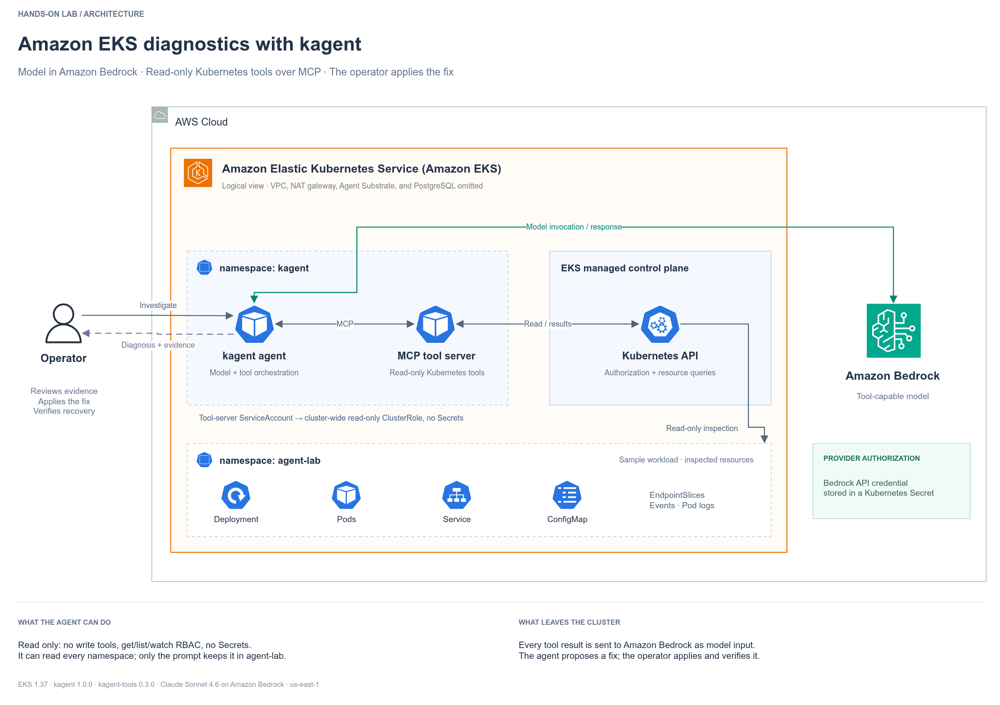

# Diagnosing Amazon EKS workloads with kagent and Amazon Bedrock

In this hands-on lab, you deploy kagent, an open-source Cloud Native Computing Foundation (CNCF) project, on Amazon EKS, connect it to a model in Amazon Bedrock, and ask it to find out why an application is down. You then break the application in three common ways and compare what the agent reports with what actually happened.

**Who this is for.** You should be comfortable with `kubectl` and the basic Kubernetes objects: Pods, Deployments, Services, and ConfigMaps. You don't need prior experience with kagent, the Model Context Protocol (MCP), Terraform, or EKS. Each one is explained where it matters.

Everything you need is in the [companion repository](https://github.com/parraletz/eks-kagent-bedrock-lab): Terraform for the AWS infrastructure, the kagent configuration, and the sample application. Every command you run is shown in this article.

## The problem

You run `kubectl get deployment demo` and the Deployment is there. `kubectl get pods` lists a Pod for it, and `kubectl get service demo` shows a cluster IP. But requests to the application fail.

Finding the cause means checking several objects: the Pod's status and events, the container's configuration, the Service's selector, the endpoints behind it, the probes. Each check is a separate `kubectl` command, and you have to connect the results yourself.

An agent can run those checks for you and summarize what it found. Its report also lists the specific fields and events behind the diagnosis. That lets you confirm it with one or two `kubectl` commands instead of repeating the whole investigation.

## What you deploy

- **An EKS cluster**, created with Terraform: a VPC, two worker nodes, and the EBS storage driver. EKS runs the Kubernetes control plane for you. Apart from creating the cluster and its AWS permissions, nothing in this lab is specific to EKS. kagent runs the same way on any Kubernetes cluster.
- **kagent**, an open-source framework for running AI agents on Kubernetes. It's a [CNCF Sandbox project](https://www.cncf.io/projects/kagent/) (accepted in May 2025), governed by the same foundation as Kubernetes. It takes your question, sends it to a model, runs the tools the model asks for, and returns the model's answer. Agents and their settings are Kubernetes resources, so you manage them with `kubectl apply`.
- **An MCP tool server** (`kagent-tools`, installed with kagent) exposes Kubernetes queries as tools: list resources, describe a resource, read events, read Pod logs. MCP is the protocol kagent uses to discover and call those tools.
- **A sample application** in the `agent-lab` namespace. This is what you break and what the agent investigates.

The model runs in **Amazon Bedrock**, outside the cluster.



### How an investigation works

When you ask a question, kagent sends it to Bedrock together with the list of tools the agent is allowed to use. The model doesn't access the cluster. It replies with a request such as "call `k8s_get_events` for namespace `agent-lab`". kagent forwards that call to the tool server, and the tool server queries the Kubernetes API using its own ServiceAccount. The result goes back to Bedrock in the next request, and the loop repeats until the model has enough information to write its report.

This has two practical consequences, and the configuration in this lab handles both:

1. **What the agent can do is decided by the tool server, not by the model.** The tool server is installed in read-only mode, without access to Secrets. The agent can inspect the cluster but cannot change it, even if the model asks.
2. **Everything a tool returns is sent to Bedrock.** If the agent reads a log line or a ConfigMap, that text leaves the cluster as part of the model's input. Keep this in mind before pointing the agent at a cluster with real data (see the [questions at the end](#questions-you-might-have)).

## Prerequisites

- An AWS account that can invoke Anthropic's Claude Sonnet 4.6 in Amazon Bedrock through the US cross-Region inference profile `us.anthropic.claude-sonnet-4-6`. Before you start, confirm that the account has a tokens-per-minute quota for the model in Service Quotas: some accounts get a quota of 0 for newer models, and requests then fail with `AccessDeniedException` (see the [questions at the end](#questions-you-might-have)).
- A short-term Bedrock API key, generated in `us-east-1`. Generate one in the Bedrock console following the [Bedrock API keys guide](https://docs.aws.amazon.com/bedrock/latest/userguide/getting-started-api-keys.html). It is valid for up to 12 hours, enough for the lab.
- On your workstation: AWS CLI (configured for your account), Terraform 1.5 or later, `kubectl`, `jq`, and Helm. The kagent CLI runs `helm` to install its charts and fails with `helm not found in PATH` if it's missing.
- The kagent CLI 1.0.0, also on your workstation. Like `kubectl`, it uses your current kubeconfig context to reach the cluster:

  ```bash
  curl -sL https://kagent.dev/install | bash -s -- --version v1.0.0
  ```

Clone the repository. All commands below run from its root:

```bash
git clone https://github.com/parraletz/eks-kagent-bedrock-lab.git
cd eks-kagent-bedrock-lab
```

## Step 1: Create the cluster and install kagent

### Create the cluster

```bash
terraform -chdir=terraform init
terraform -chdir=terraform apply
```

This takes about 15 minutes. `terraform/main.tf` creates a VPC across two Availability Zones, an EKS 1.37 cluster named `kagent-lab` in `us-east-1`, and two `m5.large` worker nodes in private subnets. It uses the community [VPC](https://registry.terraform.io/modules/terraform-aws-modules/vpc/aws) and [EKS](https://registry.terraform.io/modules/terraform-aws-modules/eks/aws) modules.

Two settings matter for kagent:

- **The EBS CSI driver add-on with a default StorageClass.** kagent's development database and Agent Substrate's snapshot store keep their data on persistent volumes. Without a storage driver, those volumes are never created and kagent never starts.
- **A node security group rule that allows all traffic between nodes.** By default, the EKS module only opens ports 1025–65535 between nodes. Agent Substrate's API server listens on port 443 and runs one replica per node, and its gateway reaches replicas on other nodes directly, Pod to Pod. Without the rule, every request that lands on the other node times out. The agent never finishes starting: its status shows `GoldenActorCrashed`, and the agent's log reports `bootstrap initialization deadline: context deadline exceeded`. The rule is `node_security_group_additional_rules.ingress_self_all` in `terraform/main.tf`.

Point `kubectl` and the kagent CLI at the new cluster. Terraform prints this command as the `configure_kubectl` output:

```bash
aws eks update-kubeconfig --region us-east-1 --name kagent-lab
```

### Install kagent

```bash
kagent --config kagent/kagent-config.yaml install --namespace kagent
```

This installs kagent, the MCP tool server, Agent Substrate (the runtime that executes agents, also a CNCF Sandbox project), and a development PostgreSQL database into the `kagent` namespace. Agent Substrate itself goes into `ate-system`.

`kagent/kagent-config.yaml` sets two things the CLI needs:

```yaml
install:
  defaultModelProvider: Bedrock   # the CLI defaults to OpenAI and fails without OPENAI_API_KEY
  kagent:
    valuesFiles:
      - kagent-values.yaml        # relative to this file, not to your working directory
```

The chart has no Bedrock defaults, so `kagent/kagent-values.yaml` also defines the provider. Without this block, the install fails while creating `default-model-config`, because its model is empty:

```yaml
providers:
  bedrock:
    provider: Bedrock
    model: us.anthropic.claude-sonnet-4-6
    apiKeySecretRef: bedrock-credentials
    apiKeySecretKey: AWS_BEARER_TOKEN_BEDROCK
    config:
      region: us-east-1
```

The rest of `kagent/kagent-values.yaml` makes the tool server read-only:

```yaml
kagent-tools:
  tools:
    enabledTools: [k8s]     # Kubernetes tools only; no shell tool
    args: ["--read-only"]   # write tools are never offered to the model
  rbac:
    readOnly: true          # get/list/watch instead of cluster-admin
    allowSecrets: false     # Secrets are not readable at all
```

Both `--read-only` and `rbac.readOnly` are needed. The flag hides write tools from the model. The RBAC setting ensures the tool server's ServiceAccount couldn't run them anyway: by default, it is bound to `cluster-admin`.

### Connect kagent to Amazon Bedrock

kagent authenticates to Bedrock with an API key, stored in a Kubernetes Secret under the exact key name `AWS_BEARER_TOKEN_BEDROCK`. The values file refers to this Secret, but the CLI doesn't create it, so you create it yourself. Paste your key when `read` waits for input. The `-s` flag keeps it off the screen and out of your shell history:

```bash
read -rs AWS_BEARER_TOKEN_BEDROCK
kubectl create secret generic bedrock-credentials -n kagent \
  --from-literal=AWS_BEARER_TOKEN_BEDROCK="$AWS_BEARER_TOKEN_BEDROCK"
unset AWS_BEARER_TOKEN_BEDROCK
```

### Create the agent

```bash
kubectl apply -f kagent/model-config.yaml -f kagent/agent.yaml
kubectl wait agent/eks-troubleshooter -n kagent --for=condition=Ready --timeout=180s
```

`kagent/model-config.yaml` tells kagent to use the Bedrock model `us.anthropic.claude-sonnet-4-6` with the key in `bedrock-credentials`.

`kagent/agent.yaml` defines the agent in three resources. The **Harness** says how the agent runs: the agent image, pinned by digest, and the Agent Substrate worker pool. Its `snapshotPolicy` points to `s3://ate-snapshots/kagent/`. That bucket isn't in Amazon S3. It lives in RustFS, an S3-compatible store that Agent Substrate runs inside the cluster. Substrate saves a started copy of the agent there and creates each new session from that copy instead of starting from scratch. The **AgentTemplate** holds the model, tools, and prompt, and the **Agent** combines the two.

The template gives the agent five read tools from the tool server: get resources, describe a resource, get a resource's YAML, read Pod logs, and read events. It also sets a system prompt. The prompt limits the investigation to `agent-lab`, forbids changes, and asks for a fixed report structure: symptom, resources inspected, evidence, diagnosis, proposed fix, and how to verify the fix. That structure is what makes the reports in the next sections quick to check.

## Step 2: Deploy the application

```bash
kubectl apply -f app/baseline.yaml
```

The application is an nginx web server:

- A **ConfigMap** named `demo-config` holds the application's settings. The container loads them as environment variables at startup.
- A **Deployment** named `demo` runs one replica that listens on port 80. A **readiness probe** requests `/` on that port every few seconds. Kubernetes sends traffic to the Pod only while the probe succeeds.
- A **Service** named `demo` routes traffic to Pods labeled `app: demo`.

The Deployment uses a single replica and the `Recreate` strategy. With more replicas or a rolling update, a healthy old Pod would keep serving traffic and hide the failures in this lab.

To tell whether the application works, send it a request the way another workload would, through the Service, from a temporary Pod inside the cluster:

```bash
kubectl run curl-check -n default --rm -i --restart=Never --quiet \
  --image=curlimages/curl:8.23.0 -- \
  curl -sS -o /dev/null -w '%{http_code}\n' -m 5 http://demo.agent-lab.svc.cluster.local
```

A healthy application returns `200`. A broken one returns `000`, because the request gets no response. This is the request to repeat after each fix. It runs in the `default` namespace on purpose: a `curl-check` Pod in `agent-lab` would show up in the agent's investigation as one more thing to explain.

## Ask the agent

The kagent CLI talks to the kagent API on port 8083. Open a port-forward in a separate terminal and leave it running for the rest of the lab:

```bash
kubectl port-forward -n kagent svc/kagent-controller 8083:8083
```

Each investigation sends the same request, stored in `task.txt`:

```text
Investigate why the demo application in the agent-lab namespace is unavailable. Inspect the cluster, support your diagnosis with evidence, and propose a fix without applying it.
```

The request doesn't say what is broken. The agent has to find the cause with its tools.

To run an investigation, create a session and send the request:

```bash
SESSION_ID=$(kagent agent session create --agent eks-troubleshooter -o json | jq -r '.session.id')
kagent agent invoke --session "$SESSION_ID" --file task.txt --stream
```

The output shows a short line before each step, such as "Let me now dig deeper into the pod spec and the deployment", followed by the final report. It doesn't show the tool calls themselves. To see exactly which queries the agent ran, open the session in the kagent UI (`kubectl port-forward -n kagent svc/kagent-ui 8080:8080`) or read the tool server's log, which records every `kubectl` command it runs:

```bash
kubectl logs -n kagent deploy/kagent-tools | grep 'executing command'
```

Create a new session for each scenario so the agent doesn't reuse findings from an earlier one. A new session doesn't clear the cluster, though. Kubernetes keeps events for about an hour, and the agent reads them, so events from the previous scenario still show up in the next one. The [results](#results) show what that costs.

## Scenario 1: The container references a ConfigMap that doesn't exist

**The fault.** The Deployment is changed to load its settings from `missing-demo-config` instead of `demo-config`. Kubernetes can't build the container's environment without that ConfigMap, so it never starts the container. The Pod exists but stays in `CreateContainerConfigError`, and the application never runs.

**How this happens in production.** This failure is common. A ConfigMap is renamed in one change while the Deployment still uses the old name. Kustomize's `configMapGenerator` adds a hash suffix to the name and a manually written reference doesn't match it. A GitOps tool applies the Deployment before the ConfigMap it depends on. Or an application is deployed to a new namespace or environment where its configuration was never created.

Introduce the fault:

```bash
kubectl patch deployment demo -n agent-lab --type=strategic \
  -p '{"spec":{"template":{"spec":{"containers":[{"name":"web","envFrom":[{"configMapRef":{"name":"missing-demo-config"}}]}]}}}}'
```

Then ask the agent:

```bash
SESSION_ID=$(kagent agent session create --agent eks-troubleshooter -o json | jq -r '.session.id')
kagent agent invoke --session "$SESSION_ID" --file task.txt --stream
```

**What a correct report says.** The diagnosis should state the cause directly:

> Pod `demo-<hash>` is in `CreateContainerConfigError`. The `web` container loads environment variables from ConfigMap `missing-demo-config` (`envFrom[0].configMapRef.name`). That ConfigMap doesn't exist in `agent-lab`; the event reads `configmap "missing-demo-config" not found`. The only ConfigMap in the namespace for this app is `demo-config`. Fix: change the reference back to `demo-config`, or create `missing-demo-config`.

**What the agent reported.** An excerpt from one of the lab runs. The excerpts in this article are trimmed and rewrapped, but the wording is the agent's:

```text
3. **Cluster event** (from the event stream):
   > `Error: configmap "missing-demo-config" not found`

4. **Deployment live spec vs last-applied annotation mismatch** – The
   `kubectl.kubernetes.io/last-applied-configuration` annotation in the
   Deployment shows the originally intended name:
   "configMapRef": {"name": "demo-config"}
   But the **live `spec`** currently reads:
   configMapRef:
     name: missing-demo-config   ← wrong name

5. **Existing ConfigMap** – `demo-config` **does exist** in the `agent-lab`
   namespace with valid data (`LAB_MODE=baseline`). The object the deployment
   needs is present; the reference to it is simply wrong.

> **A post-apply edit to the Deployment changed the `configMapRef` name from
> `demo-config` to `missing-demo-config`**, causing Kubernetes to fail to inject
> environment variables and block container creation entirely.
```

The agent proposed a `kubectl patch` that sets the reference back to `demo-config`, and didn't apply it. It also used a clue the lab didn't plan for: the `last-applied-configuration` annotation that `kubectl apply` stores on the object, which still holds the original value. That clue exists only when the object was created with client-side `kubectl apply`. With server-side apply, Helm, or most GitOps tools, the agent has to work from the live object alone.

In one of the three runs, the report quoted the event incorrectly, as `couldn't find key ... in ConfigMap agent-lab/missing-demo-config`, although the agent had quoted it correctly a few lines earlier. The diagnosis was still right, but a quote in the report isn't proof. Check it.

**Check it yourself.** The report names three facts. Each one takes a single command to confirm:

```bash
kubectl get deployment demo -n agent-lab \
  -o jsonpath='{.spec.template.spec.containers[0].envFrom}'
kubectl get events -n agent-lab --field-selector reason=Failed
kubectl get configmaps -n agent-lab
```

If the report says the application crashed, it's wrong: in this scenario the container never started, so the Pod has no logs and its restart count is 0.

**Fix it.** Reapply the original manifest, then send the `curl-check` request from Step 2. It returns `200`.

```bash
kubectl apply -f app/baseline.yaml
```

## Scenario 2: The Service doesn't select any Pods

**The fault.** The Service's selector is changed to `app: different-app`. A Service doesn't point to a Deployment. It sends traffic to any Pod whose labels match its selector, and it records those Pods in EndpointSlices. With no matching Pods, the Service has no backends and requests fail. Nothing reports an error: the Pod is `Running` and ready, the Deployment is available, and there are no warning events.

**How this happens in production.** This often follows a label change. A team migrates from `app` to `app.kubernetes.io/name` in the Deployment but not in the Service, or a Helm chart upgrade changes its label scheme. The rollout looks healthy, and the only symptom is that traffic stops.

Introduce the fault:

```bash
kubectl patch service demo -n agent-lab --type=merge \
  -p '{"spec":{"selector":{"app":"different-app"}}}'
```

The `curl-check` request now fails, even though `kubectl get pods -n agent-lab` shows the Pod as `1/1 Running`. Ask the agent in a new session:

```bash
SESSION_ID=$(kagent agent session create --agent eks-troubleshooter -o json | jq -r '.session.id')
kagent agent invoke --session "$SESSION_ID" --file task.txt --stream
```

**What a correct report says.**

> Service `demo` selects `app=different-app`. Pod `demo-<hash>` is ready and labeled `app=demo`. No Pod in `agent-lab` has `app=different-app`, so the EndpointSlice for `demo` has no endpoints. Fix: set the Service selector to `app: demo`.

**What the agent reported.**

```text
| Resource               | Field                          | Value                          |
|------------------------|--------------------------------|--------------------------------|
| `service/demo`         | `spec.selector`                | `app: different-app` ← **wrong** |
| `deployment.apps/demo` | `spec.template.metadata.labels`| `app: demo` ✅                 |
| `pod/demo-7dccfd94cb-dt49r` | Status                    | `1/1 Running` ✅               |
| `endpoints/demo`       | `subsets`                      | **empty** (no addresses)       |

> **The Service selector was accidentally changed from `app: demo` to
> `app: different-app`**, breaking the Service → Pod binding entirely.
```

It proposed `kubectl patch service demo -n agent-lab --type='json' -p='[{"op":"replace","path":"/spec/selector/app","value":"demo"}]'`.

A report that only says "the Service has no endpoints" describes the symptom, not the cause. The useful diagnosis compares the selector with the Pod labels.

**Check it yourself.**

```bash
kubectl get service demo -n agent-lab -o jsonpath='{.spec.selector}'
kubectl get pods -n agent-lab --show-labels
```

**Fix it.** Reapply the original manifest and repeat the `curl-check` request:

```bash
kubectl apply -f app/baseline.yaml
```

## Scenario 3: The Pod is running but never becomes ready

**The fault.** The readiness probe is changed to check port 8081, but nginx listens on port 80. Every probe fails with "connection refused", so Kubernetes marks the Pod as not ready and removes it from the Service's endpoints. A failing readiness probe doesn't restart the container. The Pod stays `Running` with `0/1` ready and no restarts. See [Kubernetes probes](https://kubernetes.io/docs/concepts/workloads/pods/probes/).

**How this happens in production.** An application changes its listening port, for example from 80 to 8080 so it can run as a non-root user, but the probe isn't updated. Or the probe is set to a metrics or admin port that the application doesn't open in every configuration.

Introduce the fault:

```bash
kubectl patch deployment demo -n agent-lab --type=strategic \
  -p '{"spec":{"template":{"spec":{"containers":[{"name":"web","readinessProbe":{"httpGet":{"path":"/","port":8081}}}]}}}}'
```

Wait until `kubectl get pods -n agent-lab` shows the new Pod as `0/1 Running`, then ask the agent in a new session:

```bash
SESSION_ID=$(kagent agent session create --agent eks-troubleshooter -o json | jq -r '.session.id')
kagent agent invoke --session "$SESSION_ID" --file task.txt --stream
```

**What a correct report says.**

> Pod `demo-<hash>` is `Running` with 0 restarts but not ready. The readiness probe sends `GET /` to port 8081; events show `Readiness probe failed: ... connect: connection refused`. The container's only declared port is `http` (80), which the Service targets. Fix: set the probe's port to `http`.

**What the agent reported.**

```text
#### B — Pod describe confirms the failing probe
Readiness:  http-get http://:8081/ delay=2s timeout=1s period=3s successThreshold=1 failureThreshold=3
Ready:      False

**Primary (high confidence):** The readiness probe's `httpGet.port` field was
incorrectly changed from the named port `"http"` (which resolves to `80`) to
the integer `8081` ...
```

It proposed a JSON patch that sets the probe's port back to `http`.

Be careful with two wrong conclusions here. The problem isn't a liveness probe or a crashing process, because the container isn't restarting. And `containerPort: 80` in the manifest is only a declaration. The probe event is what shows that nothing answers on 8081.

The agent's report shows why this matters. It states that nginx listens "only on port 80 (confirmed by logs)", but nginx's startup log doesn't mention the port. The conclusion is right, but that piece of evidence is an inference presented as an observation. Read the evidence section of a report as critically as the diagnosis.

**Check it yourself.**

```bash
kubectl get pods -n agent-lab
kubectl describe pod -n agent-lab -l app=demo | grep -A2 Readiness
```

**Fix it.** Reapply the original manifest and repeat the `curl-check` request:

```bash
kubectl apply -f app/baseline.yaml
```

## Results

Each scenario ran three times, in a new session each time, with Claude Sonnet 4.6. Before each run, `agent-lab` was deleted and recreated from `app/baseline.yaml`, so the agent saw only the current fault. Durations are measured by the client. Tool calls come from the tool server's log. Token counts come from the `InputTokenCount` and `OutputTokenCount` metrics that Bedrock publishes to Amazon CloudWatch.

| Scenario | Runs with correct cause | Avg. tool calls | Avg. model requests | Avg. duration | Avg. input / output tokens | Avg. cost |
| - | - | - | - | - | - | - |
| Missing ConfigMap | 3 / 3 | 6 | 4 | 22 s | 25,700 / 1,800 | USD 0.12 |
| Wrong Service selector | 3 / 3 | 7.3 | 4.7 | 22 s | 26,400 / 1,800 | USD 0.12 |
| Wrong probe port | 3 / 3 | 7 | 4 | 26 s | 28,500 / 2,200 | USD 0.13 |

In all nine runs, the agent identified the cause, cited the field that changed, and proposed a `kubectl patch` command to revert it. The commands were syntactically correct, but they weren't run: each fix was made by reapplying `app/baseline.yaml`. The agent didn't try to change anything. Every command the tool server ran during the lab was a `get`, `describe`, or `logs`. The two flaws in the reports are the ones described in the scenarios: a misquoted event in one run, and evidence that was really an inference.

**The same scenarios with history in the namespace.** A first set of nine runs used the lab as written: fix the fault with `kubectl apply`, then move on to the next scenario in the same namespace. The diagnoses were just as accurate, 9 of 9, but they cost more:

| | Avg. input tokens | Avg. cost | Most expensive run |
| - | - | - | - |
| Clean namespace | 26,900 | USD 0.12 | USD 0.13 |
| Namespace with events from earlier runs | 69,600 | USD 0.26 | USD 0.39 |

The tool behind the difference is `k8s_get_events`. It runs `kubectl get events -o json` for the whole namespace, and the agent called it in every run. Each fault and recovery adds events, so input tokens grew run after run, from 34,500 in the first run to 108,000 in the ninth. The extra events didn't change any diagnosis, but they showed up in the reports. In one run, the agent listed the ConfigMap failure from an earlier scenario as a "pre-existing issue, already recovered".

## Cost

### This lab

The lab runs for about two to three hours. Prices are on-demand list prices in `us-east-1` at the time of writing.

| Resource | Created by | Rate | Lab (3 hours) |
| - | - | - | - |
| EKS control plane | Terraform | USD 0.10/hour | USD 0.30 |
| 2 × m5.large nodes | Terraform | USD 0.096/hour each | USD 0.58 |
| NAT gateway | Terraform | USD 0.045/hour + USD 0.045/GB | USD 0.15 |
| Public IPv4 address (NAT gateway) | Terraform | USD 0.005/hour | USD 0.02 |
| EBS gp3: 2 × 20 GB node volumes + 1 GiB PostgreSQL volume + 1 GiB RustFS volume | Terraform, kagent | USD 0.08/GB-month | < USD 0.05 |
| Bedrock, Claude Sonnet 4.6 (`us.` inference profile) | each investigation | USD 3.30 per million input tokens, USD 16.50 per million output tokens | ~ USD 1.50 (10 investigations) |
| **Total** | | | **~ USD 2.60** |

Bedrock costs depend on how much the agent reads. Each tool result is added to the conversation, and the whole conversation is sent to the model again on each step, so input tokens grow with every call. In the [results](#results), an investigation used about 27,000 input and 1,900 output tokens in a clean namespace, or USD 0.12. With an hour of events from earlier faults in the namespace, the average rose to USD 0.26, and the most expensive run cost USD 0.39. The estimate above assumes about USD 0.15 per investigation.

The `us.` inference profile routes requests to US Regions and costs 10% more than the `global.` profile (`global.anthropic.claude-sonnet-4-6`, USD 3 and USD 15 per million tokens), which can route them to any supported Region. Use `us.` if your data has to stay in the US.

### A two-pizza team in production

Assumptions: a team of six to eight engineers. The agent runs in a small dedicated operations cluster and uses the Helm installation with Amazon RDS for PostgreSQL instead of the bundled development database. The team runs 15 investigations per working day, about 315 per month.

| Resource | Monthly estimate |
| - | - |
| EKS control plane | USD 73 |
| 2 × m5.large nodes (on-demand) | USD 140 |
| NAT gateway (hours only) | USD 33 |
| Public IPv4 address | USD 4 |
| RDS for PostgreSQL, db.t4g.medium Multi-AZ, 20 GB | USD 100 |
| EBS volumes | USD 5 |
| Bedrock: 315 investigations × ~USD 0.25 | USD 80 |
| **Total** | **~ USD 435 per month** |

The Bedrock line uses USD 0.25 per investigation, close to the lab's runs in a namespace with history. Production namespaces always have history.

What changes this number:

- **Running kagent in an existing cluster** removes the control plane, NAT gateway, and most of the node cost. You pay for the capacity kagent uses on your nodes, plus RDS and Bedrock: roughly USD 200 per month.
- **Investigation volume and size** affect only the Bedrock line. At 50 investigations per day, Bedrock is about USD 260 per month. What the agent reads matters more than how often it runs: a busy namespace with thousands of events, or large logs, can cost several times the estimate per investigation. The `global.` inference profile lowers this line by about 10%.
- **Savings Plans or Reserved Instances** reduce the node and RDS costs by about a third.

Check [Amazon EKS pricing](https://aws.amazon.com/eks/pricing/), [Amazon Bedrock pricing](https://aws.amazon.com/bedrock/pricing/), [Amazon VPC pricing](https://aws.amazon.com/vpc/pricing/), and [Amazon RDS for PostgreSQL pricing](https://aws.amazon.com/rds/postgresql/pricing/) for current rates.

## Cleanup

The order matters. kagent's two volumes, for the PostgreSQL database and for Agent Substrate's RustFS store, were created by Kubernetes, not by Terraform, so Terraform doesn't know about them. Remove kagent while the cluster and its storage driver are still running, so the volumes are deleted with it:

```bash
kubectl delete namespace agent-lab
kagent uninstall --namespace kagent
kubectl delete namespace kagent
```

`kagent uninstall` removes the agent, the ModelConfig, the tool server, Agent Substrate, the development PostgreSQL instance, all `kagent.dev` and `ate.dev` CRDs, and the `ate-system` namespace. Deleting the `kagent` namespace removes the Bedrock Secret and the database's PersistentVolumeClaim. Before you continue, wait until no PersistentVolume is left, which means the EBS volumes are gone. This command should print `No resources found`:

```bash
kubectl get pv
```

Then delete the AWS infrastructure:

```bash
terraform -chdir=terraform destroy
```

This removes everything Terraform created: the EKS cluster and node group, the VPC with its subnets, NAT gateway, Elastic IP, and internet gateway, the IAM roles for the cluster, the nodes, and the EBS CSI driver, the cluster's OIDC provider, and its CloudWatch log group. In the lab run, `terraform destroy` took about 12 minutes and removed 61 resources. The KMS key that encrypts the cluster's Secrets can't be deleted immediately. Terraform schedules it for deletion, and AWS removes it after the waiting period, 30 days by default.

Finally, check that no volume from the lab is left behind. The command should print nothing:

```bash
aws ec2 describe-volumes --region us-east-1 \
  --filters Name=tag:kubernetes.io/created-for/pvc/namespace,Values=kagent,ate-system \
  --query 'Volumes[].VolumeId' --output text
```

On the Bedrock side, a short-term API key expires on its own and leaves no resource to delete. If you used a long-term key, delete it in the Bedrock console, along with the IAM user the console created for it. Enabling model access doesn't create billable resources.

## Questions you might have

**The agent never becomes ready. What should I check?**
Look at its conditions with `kubectl get agent eks-troubleshooter -n kagent -o jsonpath='{.status.conditions}' | jq`. If `Ready` is `False` with a reason like `ActorTemplateRetrying` or `GoldenActorCrashed`, Agent Substrate can't finish starting the agent. On EKS, the usual cause is the node security group: check that the `ingress_self_all` rule from `terraform/main.tf` exists. Once traffic between nodes is open, the agent becomes ready on Substrate's next retry, within seconds.

**Requests fail with `AccessDeniedException` even though model access is enabled. Why?**
Check the model's quota under Amazon Bedrock in Service Quotas. Each model has its own tokens-per-minute quota, set separately for the `us.` and `global.` inference profiles, and some accounts get a quota of 0 for newer models. A Marketplace agreement for the model doesn't change that. If the quota is 0, request an increase or use a model with a quota. This lab moved from Claude Sonnet 5.5 to Claude Sonnet 4.6 for that reason. Also check that the key was generated in the same Region as `bedrock.region` in the ModelConfig.

**Why a Bedrock API key instead of IRSA or EKS Pod Identity?**
In kagent 1.0, agents run as Agent Substrate actors, not as Pods with their own ServiceAccount, so there is no Pod to attach an IAM role to. kagent also rejects static access keys (`AWS_ACCESS_KEY_ID`/`AWS_SECRET_ACCESS_KEY`) for Bedrock. The API key is the supported option. See [Amazon Bedrock integration](https://kagent.dev/docs/kagent/latest/setup/model-providers/amazon-bedrock/).

**Why install kagent with its CLI instead of Helm or Terraform?**
The CLI installs Agent Substrate and a development PostgreSQL instance in one step. The Helm installation is the production option, and it fits naturally into Terraform, but you have to provide PostgreSQL 15 or later (with pgvector, for long-term memory), a CA, a JWT pool, and several Secrets yourself. For production, use Helm with Amazon RDS and `sslmode=verify-full`.

**Why Kubernetes 1.37?**
Agent Substrate depends on the `PodCertificateRequest` and `ClusterTrustBundle` APIs, which became generally available in 1.37. See [Install kagent](https://kagent.dev/docs/kagent/latest/setup/installation/).

**Can the agent change anything in my cluster?**
No. Write tools aren't offered to the model, and the tool server's ServiceAccount can only `get`, `list`, and `watch`. You can confirm this with `kubectl auth can-i patch deployments -n agent-lab --as=system:serviceaccount:kagent:kagent-tools`, which returns `no`. In this lab's runs, every command the tool server ran was a `get`, `describe`, or `logs`.

**What can the agent read?**
More than the `agent-lab` namespace. The read-only ClusterRole applies to the whole cluster, so the tool server can read Pods, ConfigMaps, events, and logs in every namespace, including `kube-system`. The system prompt tells the agent to stay in `agent-lab`, but a prompt is an instruction, not a permission boundary. The chart's `remoteMCPServer.allowedNamespaces` setting doesn't help: it controls which namespaces' agents can use the server, not what the server can read. kagent 1.0 doesn't document a way to restrict the bundled tool server to one namespace.

That's why this lab uses its own cluster. On a shared cluster, run a separate tool server bound to a namespaced Role, or give the agent its own cluster.

**What data is sent to Bedrock?**
Everything the tools return: resource definitions, events, and any logs or ConfigMaps the agent decides to read. Logs and ConfigMaps often contain internal hostnames, customer identifiers, or credentials that should have been Secrets. Before using the agent on a real cluster, make sure everything the tool server can read is data you're willing to send to the model.

**Is the MCP tool server exposed outside the cluster?**
No. It's only reachable through a `ClusterIP` Service, inside the cluster. It doesn't require authentication from callers in the cluster, though. Any Pod that can reach the Service could call its tools, using the tool server's read permissions. On a shared cluster, add a NetworkPolicy that only allows traffic from kagent's components. On EKS, NetworkPolicy enforcement requires enabling network policy support in the Amazon VPC CNI add-on. This lab doesn't include a NetworkPolicy. Agent sessions reach the tool server through Agent Substrate's gateways in `ate-system`, so test any policy against a running agent before relying on it.

**Which versions were tested?**
EKS 1.37 (`v1.37.1-eks`), kagent 1.0.0 (CLI, charts, and Agent Substrate), kagent-tools 0.3.0, Helm 4.3.1, Terraform 1.15 with AWS provider 6.73, and the `terraform-aws-modules` VPC 6.7, EKS 21.29, and EKS Pod Identity 2.10 modules. The model was Claude Sonnet 4.6 through the `us.anthropic.claude-sonnet-4-6` inference profile, in November 2026. kagent 1.0 doesn't support in-place upgrades from 0.10.x, so don't mix instructions from earlier releases.

## Next steps

The agent found the cause in all 18 runs of this lab. These are three short, well-defined faults, though, each with one wrong field, so don't read that as an error rate. The more useful findings are about cost and evidence. What the agent reads determines what an investigation costs. And its reports are accurate enough to save time, but not accurate enough to act on without checking.

- **Part 2 of this series** runs the same three scenarios with other models available in Bedrock: OpenAI's gpt-oss-120b, Qwen3 Next 80B, and Amazon Nova Pro. It compares accuracy, investigation depth, duration, and cost per diagnosis, with and without event history in the namespace.
- Reduce what the agent reads about events. They're the largest source of input tokens. Ask for warning events only in the system prompt, or put a tool in front of `k8s_get_events` that filters them by type and age.
- Run the agent on a failure you've had in your own environment, in a non-production cluster.
- Add tools the agent doesn't have yet, such as CloudWatch metrics or the AWS Load Balancer Controller's events, so it can investigate problems outside Kubernetes objects.
- For production, move to the Helm installation with Amazon RDS and a dedicated, namespace-scoped tool server.
